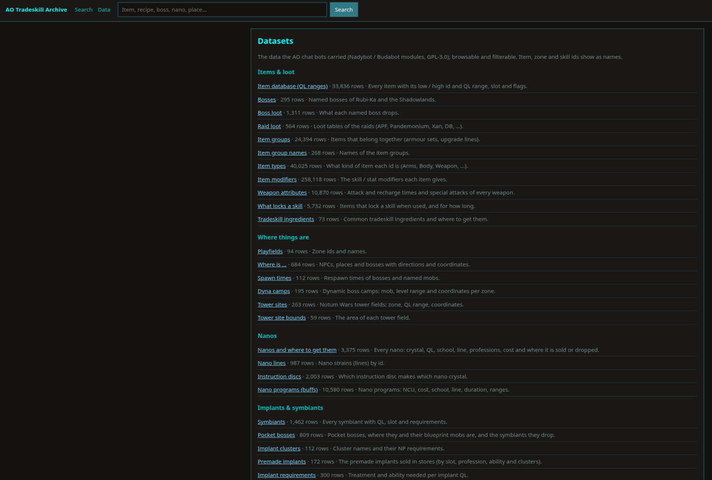
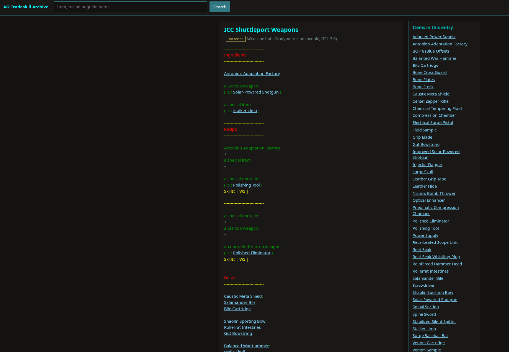

# AO_Wiki_Docker

**An offline wiki for Anarchy Online**, in one Docker container: the tradeskill recipes and the
data the old in-game chat bots served, searchable in your browser and linked together.

Search once and you get recipes, items and data rows. Every item has a page that gathers everything
about it: what makes it, which boss drops it, where a nano is sold, which pocket boss drops a
symbiant, what an item buffs. Anarchy Online is near its end; this is meant to keep working after
the servers and fan sites are gone, so it never connects to the game or the internet.

- 666 tradeskill recipes (the recipe-bot recipes) and 13 bot guides
- 151 recipe texts from the game's own items (construction manuals, Engineering News, ...)
- 56 bot datasets, 506,035 rows: boss and raid loot, NPC / boss locations, spawn times, nanos and
  where to get them, symbiants and pocket bosses, implants and clusters, perks, Ofab and alien gear,
  LE procs, levels, trickle-down, whompahs, ...
- 120,835 item names, with QL ranges where known





## Quick start

You need [Docker](https://docs.docker.com/get-docker/) (Docker Desktop on Windows / macOS).

```sh
git clone https://github.com/CrimsonMage/AO_Wiki_Docker.git
cd AO_Wiki_Docker
docker compose up -d
```

Open **<http://localhost:8080>**. Stop it with `docker compose down`. It starts again by itself
after a reboot until you stop it.

Without Compose:

```sh
docker build -t ao-wiki .
docker run -d --name ao-wiki -p 127.0.0.1:8080:8080 ao-wiki
```

The build takes a minute: it creates the database from `data/` and checks that every file and row
made it in (`build/verify.py`); it stops with an error if anything is missing.

### Troubleshooting

- **`port is already allocated`**: something else uses 8080. Use another port on the left side,
  e.g. `-p 127.0.0.1:8081:8080` (or `"127.0.0.1:8081:8080"` in `docker-compose.yml`) and open
  <http://localhost:8081>.
- **`permission denied ... docker.sock`** (Linux): run the commands with `sudo`, or add yourself to
  the `docker` group (`sudo usermod -aG docker $USER`, then log out and in).
- **Reach it from other computers on your network**: drop `127.0.0.1:` from the port mapping.

### Without Docker

Python 3.10 or newer, standard library only:

```sh
python3 build/build_db.py archive.sqlite
python3 build/verify.py archive.sqlite
python3 app/server.py --db archive.sqlite --port 8080
```

## Using it

| Page | What it shows |
|---|---|
| `/` | Search: recipes and guides, items, and rows from the datasets |
| `/item/<id>` | Everything about one item, with its QL range |
| `/data` | All datasets by topic; `/d/<name>` one dataset, with a filter and 50 rows per page |
| `/e/<key>` | One recipe, guide or item text, every item in it a link |

There is no JavaScript and nothing is loaded from the internet. Item ids anywhere in the data link to
their item page; zone and skill ids are shown with their names.

### JSON API

| Path | Returns |
|---|---|
| `/api/search?q=carbonum&limit=50` | `entries` (recipes / guides), `items` and `data` (dataset rows) |
| `/api/entry/recipe-101` | one entry (`recipe-N`, `text-N`, `botguide-N`, `guide-N`) with its HTML and items |
| `/api/item/121571` | an item, its QL range, and the entries and dataset rows that mention it |
| `/api/datasets` | the datasets with their columns and sizes |
| `/api/d/nanos?q=composite&p=0` | rows of one dataset, filtered, 50 per page |
| `/api/d/nanos/498` | one row |
| `/api/stats` | how many of each are in the archive |

## What is inside

| Source | Size | Folder | License |
|---|---|---|---|
| The recipe-bot recipes: the recipes written for AO-Universe's recipe bot and shipped by Budabot / Nadybot / Bebot ([Nadybot RECIPE_MODULE](https://github.com/Nadybot/Nadybot)) | 666 | `data/recipes/` | GPL-3.0 |
| The bots' datasets and guides ([Nadybot](https://github.com/Nadybot/Nadybot) modules, branch `nadybot7`, Aug 2026) | 56 datasets, 13 guides | `data/nadybot/` | GPL-3.0 |
| Item names, from the game's item database | 120,830 | `data/items.tsv` | game data © Funcom |
| The game's own recipe texts (item descriptions that are tradeskill instructions) | 151 | `data/item_texts.json` | game text © Funcom |

`data/recipes/SOURCE.md` and `data/nadybot/SOURCE.md` name the exact commits. The datasets, by topic:

- **Items & loot:** the bots' item table with QL ranges, boss loot and boss names, raid loot (APF,
  Pandemonium, Xan, ...), item groups, item types, item and nano-program modifiers, weapon attack /
  recharge times and specials, what locks a skill, tradeskill ingredients and where to get them.
- **Where things are:** "where is" answers for NPCs, places and bosses with coordinates, spawn times,
  dyna camps, tower sites and their bounds, playfields.
- **Nanos:** every nano with QL, school, line, professions, cost and where it is sold or dropped;
  nano lines, instruction discs, nano programs.
- **Implants & symbiants:** symbiants, pocket bosses with their blueprint mobs and drops, clusters,
  premade implants, implant requirements, the implant designer matrix, spirits.
- **Alien & endgame:** LE research procs, Ofab armour and weapons with their costs, Kyr'Ozch weapons
  and specials, Arul Saba bracers.
- **Character:** perks (every level), levels (XP / SK, team and PvP ranges, mission XP), research,
  trickle-down; skill, ability and profession ids.
- **Travel:** whompah cities and links.

### AO-Universe guides (optional, not in this repository)

AO-Universe's tradeskill guides (about 190, e.g. the Arete starter weapon upgrades) fit in too, but
they are their authors' work, so they are not published here. If you have them as
`data/aou/guides.json` (built by `build/import_data.py`), `docker build -f Dockerfile.full -t
ao-wiki:full .` makes an image that includes them. Please ask AO-Universe
(<https://www.ao-universe.com>) before sharing such an image.

## Updating or extending the data

- `build/build_db.py` builds the database from `data/` in a few seconds; `build/verify.py` re-reads
  every source and checks each file, row and needed column.
- A new bot dataset: put the CSV under `data/nadybot/` and describe it in `build/datasets.py`
  (title, which columns hold item / zone / skill ids, what names a row). `verify.py` fails until
  every CSV there is described.
- `build/import_data.py` turns exported item names / item texts (plain Lua tables) into
  `data/items.tsv` and `data/item_texts.json`.

## License

- **This project's own work** (`app/`, `build/`, the Dockerfiles, `docker-compose.yml`, the docs) is
  released into the **public domain** under [The Unlicense](LICENSE): do whatever you want with it.
- **`data/recipes/` and `data/nadybot/`** come from the Nadybot project and stay under the
  **GPL-3.0** (`LICENSE` in each folder). You can use and share them freely; changed versions of
  those files must stay GPL-3.0 and say where they came from.
- **Item names and texts** are Anarchy Online game data, © Funcom.

Unofficial fan project, not affiliated with Funcom, Nadybot or AO-Universe. Thanks to the Nadybot,
Budabot and Bebot authors, the recipe writers, and AO-Universe.
